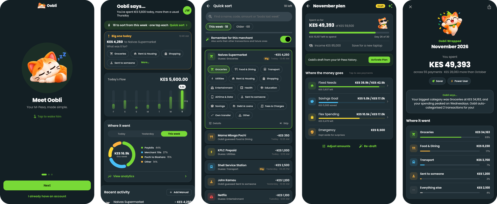

<p align="center">
  
</p>

<h1 align="center">Oobli</h1>

<p align="center">
  <b>See where your money goes. Sort every transaction in one tap.</b><br>
  An open-source spending companion that reads your M-Pesa and bank SMS and turns them into clear numbers.
</p>

<p align="center">
  <a href="https://github.com/James-CodeX/Oobli/releases/latest">Download the Android app</a> ·
  <a href="https://oobli.jimicore.tech">Website</a> ·
  <a href="#build-it-yourself">Build it yourself</a> ·
  <a href="#swap-the-ai-engine">Swap the AI engine</a>
</p>

<p align="center">
  
</p>

---

## Why Oobli exists

I spend almost everything through M-Pesa and my bank, and the messages pile up: Tills, Paybills, Pochi la Biashara, Send Money, card payments. At the end of the month I couldn't say where the money went. Spreadsheets didn't last a week, and every budgeting app I tried wanted me to type each transaction by hand.

So I built the app I wanted. Oobli reads the money messages already on my phone, sorts them into categories, learns from my corrections, and shows me the numbers that matter, all without me typing anything.

## What it does

- **Reads your money SMS.** M-Pesa (Tills, Paybills, Pochi la Biashara, Send Money, Fuliza, M-Shwari) and bank messages are parsed **on the phone**. Only messages from financial senders are read; personal chats are never touched.
- **Sorts automatically, and learns.** Your own corrections come first, then offline keyword rules, then AI for whatever is left. Correct a merchant once and Oobli remembers it.
- **Quick sort.** Anything Oobli isn't sure about goes into a queue you clear with one tap per transaction. It also offers to file similar merchants the same way.
- **Oobli says…** A home screen that tells you how today compares with a usual day, what went out, and where it went.
- **Charts and analytics.** Today, yesterday, this week, a month, six months or a year, by category and by channel.
- **Plain-English search.** Type "boda last month" or "food over 1000" in Activity.
- **Upcoming bills.** Repeating payments are spotted automatically, with a warning when your balance won't cover the week.
- **Monthly plans and goals.** An AI-drafted budget that fits your pay, and savings goals with progress.
- **Wrapped.** A monthly recap of what you spent, where it went and what you did well.
- **Ask Oobli.** Chat with an assistant about your own spending.
- **Feels good to use.** Playful onboarding, a mascot with twelve moods, light and dark themes, offline-first sync and in-app updates.

## Get the app

- **Download:** the signed APK is on the [latest release](https://github.com/James-CodeX/Oobli/releases/latest). Most phones want `oobli-<version>-arm64-v8a.apk`; `universal.apk` works everywhere.
- **Build it yourself:** see [below](#build-it-yourself).

Oobli is **Android only** for now (see [iOS](#ios) for why, and how a port could work).

## How it works

```
Flutter app (Android)                         Appwrite (backend)
├─ SMS inbox (Kotlin channel, financial       ├─ Auth: email/password
│  senders only) → on-device parser →         ├─ TablesDB "oobli" (row-level security, per user)
│  rules → categoriser                        │    transactions · merchant_rules · plans · goals
├─ Offline-first store + upload queue         └─ Function "oobli-ai" (Node 22)
├─ Riverpod state, go_router navigation              └─ LLM provider (Gemini by default)
└─ Appwrite SDK ──────────────────────────────────→  key held server-side only
```

- **No secrets in the app.** The LLM is only called from the `oobli-ai` function, which holds the API key and rejects anonymous calls.
- **AI is optional at every step.** Every AI feature has an offline fallback (`lib/domain/local_insights.dart`, keyword rules, the offline search parser). With no AI at all, Oobli still sorts, charts and plans.
- **Own money moves** (cash deposits, sending to yourself, refunds) are filed as *Own transfer* and kept out of spending and income (`lib/domain/money_moves.dart`).
- **De-duplication:** each transaction has a fingerprint (code + amount + direction) with a unique index, so re-syncing is safe.

### Code layout

| Path | Purpose |
| --- | --- |
| `lib/core` | config, theme tokens, formatting, errors, networking |
| `lib/data` | models, Appwrite repositories, AI client, SMS parser and sync |
| `lib/domain` | pure logic: stats, bills, search, insights, similar merchants |
| `lib/state` | Riverpod controllers |
| `lib/ui/widgets` | design system: buttons, mascot, charts, cards |
| `lib/features` | screens: onboarding, auth, dashboard, activity, analytics, plans, goals, wrapped, settings, Ask Oobli |
| `functions/oobli-ai` | the AI gateway (Appwrite Function) |
| `web` | landing page, terms and privacy (Vite + React) |
| `test` | unit tests and screen tests with golden images |

## Build it yourself

You need [Flutter](https://docs.flutter.dev/get-started/install) (stable), an Android phone with USB debugging, and your own [Appwrite](https://appwrite.io) project (Cloud or self-hosted).

### 1. Set up your backend

In your Appwrite project:

1. **Auth:** enable Email/Password.
2. **Android platform:** add one with your app's package name (`com.oobli.oobli`, or your own if you change it).
3. **Database** with ID `oobli` and these tables. Turn on **row security** for each, and give the `users` role *create* permission at table level.

| Table | Columns | Indexes |
| --- | --- | --- |
| `transactions` | `userId` string, `fingerprint` string, `amount` float, `direction` string, `merchant` string, `category` string, `channel` string, `source` string, `occurredAt` datetime, `reference` string?, `rawMessage` string?, `aiCategorized` boolean, `confirmed` boolean, `note` string?, `balance` float? | `(userId, occurredAt)`, unique `(userId, fingerprint)` |
| `merchant_rules` | `userId` string, `merchantKey` string, `category` string | unique `(userId, merchantKey)` |
| `plans` | `userId` string, `month` string, `income` float, `status` string, `allocations` string (JSON), `goal` string?, `focus` string?, `summary` string? | `(userId, month)` |
| `goals` | `userId` string, `title` string, `icon` string, `target` float, `saved` float, `deadline` datetime?, `isPrimary` boolean, `tone` string | `(userId)` |

`?` marks optional columns. The exact shapes live in `lib/data/models/*.dart` (`toRow`).

4. **AI function** (optional but recommended): see [Deploying the AI function](#deploying-the-ai-function).

### 2. Run the app against it

```bash
flutter pub get
flutter run \
  --dart-define=APPWRITE_ENDPOINT=https://<your-region>.cloud.appwrite.io/v1 \
  --dart-define=APPWRITE_PROJECT_ID=<your-project-id>
```

Release build:

```bash
flutter build apk --release --dart-define=APPWRITE_ENDPOINT=... --dart-define=APPWRITE_PROJECT_ID=...
```

The defaults in `lib/core/config/app_config.dart` point at the official Oobli backend. **Use your own project for anything you build or change**, so your data and AI costs stay yours.

## Swap the AI engine

Oobli ships with Google Gemini, but nothing depends on it. Pick whichever fits you.

### A cloud LLM (Claude, OpenAI, DeepSeek, Mistral, a local server…)

Every AI feature in `functions/oobli-ai/src/handlers.js` talks to the model through a single function:

```js
generate({ system, input, schema }) // → text, or parsed JSON when a schema is given
```

To switch providers, write a client with the same `generate` (look at `src/gemini.js`, about 100 lines) and create it in `src/main.js` instead of `createGemini`. Roughly:

- Send `system` as the system prompt and `input` as the user message.
- When `schema` is set, ask for JSON matching it (structured outputs, JSON mode or tool calling, depending on the provider) and return the parsed object.
- Put the provider's API key in a secret function variable, never in the app.

Any OpenAI-compatible endpoint (DeepSeek, Mistral, Groq, OpenRouter, Ollama, LM Studio, vLLM…) works with the same client by changing the base URL and model name.

### A small model on the phone

For fully offline, private AI, skip the function and run a small model on the device (for example a 1–3B Gemma, Llama, Qwen or Phi model through MediaPipe LLM Inference or a llama.cpp binding). All AI calls in the app go through `AiService` (`lib/data/services/ai_service.dart`): categorise, parse SMS, insights, plan, wrapped, chat, similar and search. Implement those methods against your on-device model and override `aiServiceProvider`. The offline fallbacks cover anything a small model doesn't handle well.

## iOS

The app is Flutter, so most of it runs on iOS as-is. The catch: **iOS does not let apps read SMS**, so the automatic import has to come in another way, for example:

- an iOS Shortcuts automation that forwards money messages to the app,
- pasting or sharing a message into Oobli (the parser already handles single messages),
- manual entry, which already exists (**Add Manual**).

Contributions here are very welcome.

## Deploying the AI function

The function has no npm dependencies. From `functions/oobli-ai`:

```bash
tar -czf code.tar.gz package.json src
appwrite functions create-deployment --function-id oobli-ai --code code.tar.gz --activate true
```

Variables: `GEMINI_API_KEY` (secret), `GEMINI_MODEL` (default `gemini-3.5-flash-lite`), optional `GEMINI_FALLBACK_MODEL`, `GEMINI_ATTEMPT_TIMEOUT_MS`. Give the function *execute* access for the `users` role.

## Tests

```bash
flutter analyze
flutter test                      # unit + screen tests
flutter test --update-goldens     # regenerate screen snapshots after UI changes
cd functions/oobli-ai && npm test # AI function tests
cd web && npm test                # website tests
```

## Themes and branding

- One font family, **Poppins**, set in `lib/core/theme/oobli_text.dart`.
- Light and dark themes come from the design tokens in `lib/core/theme`. The app follows the phone's setting; users can force either in **Settings → App Theme**.
- Oobli's sticker poses are in `assets/mascot/`, one per mood (`MascotMood` in `lib/ui/widgets/mascot.dart`).
- Launcher icon and launch screen come from `assets/branding/`:

```bash
dart run flutter_launcher_icons
dart run flutter_native_splash:create
```

## Releases (GitHub Actions)

- **CI** runs analyze and tests on every push and pull request.
- **Release** runs on version tags and publishes signed APKs (universal and per-ABI), an `.aab`, checksums and the in-app update manifest:

```bash
git tag v1.7.0 && git push origin v1.7.0
```

Signing uses the repository secrets `ANDROID_KEYSTORE_BASE64`, `ANDROID_KEYSTORE_PASSWORD`, `ANDROID_KEY_PASSWORD` and `ANDROID_KEY_ALIAS`. Local release builds read `android/key.properties` (git-ignored).

- **Web** tests and builds `web/` when it changes. The site itself is deployed by Appwrite Sites, which is connected to this repository and redeploys on every push to `main`.
- **CI** skips changes that only touch the website or docs.
- The Release workflow uploads each APK to the public `downloads` bucket for the website's download button. It needs an `APPWRITE_API_KEY` secret with `files.read` and `files.write`.

## Publishing your own build

- **Google Play SMS policy:** `READ_SMS` is a restricted permission. Play only allows it for approved use cases, so submit the Permissions Declaration Form (SMS-based budgeting is a recognised exception) or distribute the APK directly.
- Change the package name (`android/app/build.gradle.kts`) and the app name if you publish your own version.

## Contributing

Issues and pull requests are welcome: new bank message formats, an iOS import path, other AI providers, translations, design polish. Please run `flutter analyze` and `flutter test` before opening a pull request, and update goldens when you change a screen.

## License

[MIT](LICENSE). Use it, change it, ship your own version.
